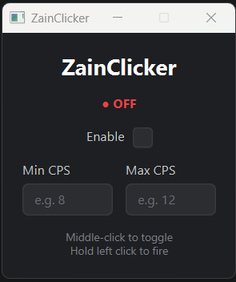

# ZainClicker

A lightweight desktop autoclicker built with **Java** and **JavaFX**. It clicks at a randomised speed within a range you choose, but only while you're holding the left mouse button, so you stay in control the whole time. A global middle-click shortcut toggles it on and off from any window.




---

## Downloads

See [Releases](https://github.com/ZainnDev/ZainClicker/releases) for the ZainClicker executable download.

---

## Features

- **Hold-to-click.** Clicks only fire while you're physically holding the left mouse button, and stop the moment you let go.
- **Randomised CPS.** Set a minimum and maximum clicks per second. Each click picks a fresh random speed within that range, giving a natural, uneven rhythm rather than a robotic fixed interval.
- **Global toggle.** Middle-click anywhere on your screen to switch the clicker on or off, even when the ZainClicker window isn't focused.
- **Live status indicator.** A clear green **● ON** / red **● OFF** label shows the current state at a glance.
- **Input validation.** The CPS fields only accept whole numbers, so invalid values can't be entered.
- **Dark theme.** A clean, compact interface styled with JavaFX CSS.

---

## How it works

| Part | What it does |
|---|---|
| **JavaFX** | Builds the window, controls and dark theme (styled via `style.css`). |
| **JNativeHook** | Listens to the mouse system-wide, so the middle-click toggle and the "left button held" check work in any app. |
| **`java.awt.Robot`** | Sends the actual left clicks. |
| **Background thread** | Runs the click loop separately from the GUI, so the window never freezes. |

The program uses JNativeHook to watch for real mouse button presses. Because the clicks it generates itself also pass through the system, it keeps a count of the "fake" events it's about to create and ignores them. This means only *your* presses and releases decide whether the button is being held.

---

## Requirements

- **JDK 17 or newer** (JavaFX 21 requires Java 17+)
- **Maven** is not required separately; the included Maven wrapper (`mvnw`) downloads it for you
- Windows, macOS or Linux

### Dependencies

Maven handles these automatically:

| Library | Version |
|---|---|
| [OpenJFX](https://openjfx.io/) (`javafx-controls`) | 21.0.6 |
| [JNativeHook](https://github.com/kwhat/jnativehook) | 2.2.2 |

---

## Getting started

### Clone the repository

```bash
git clone https://github.com/ZainnDev/ZainClicker.git
cd ZainClicker
```

### Run with IntelliJ IDEA

1. Open the project folder in IntelliJ IDEA.
2. Wait for Maven to finish downloading dependencies.
3. Open `src/main/java/zain/zainclicker/Launcher.java`.
4. Click the green ▶ next to `public class Launcher` and choose **Run**.

> **Note:** Always start the app from `Launcher`, not `ZainClicker`. The project doesn't use Java modules, and JavaFX requires the entry point to be a separate class from the one that extends `Application`.

### Run with the Maven wrapper

```bash
./mvnw clean javafx:run
```

On Windows Command Prompt or PowerShell, use `mvnw.cmd clean javafx:run` instead.

---

## Usage

1. Enter a **Min CPS** and a **Max CPS** (for example, 8 and 12).
2. **Middle-click** anywhere, or tick **Enable**, to switch the clicker on. The status changes to **● ON**.
3. **Hold the left mouse button** to start clicking. Release it to stop.
4. **Middle-click** again to switch the clicker off.

### Controls

| Input | Action |
|---|---|
| Middle mouse button | Toggle the clicker on / off (works globally) |
| Hold left mouse button | Fire clicks while enabled |
| Release left mouse button | Stop clicking |

### Tips

- If you enter the minimum and maximum the wrong way round, ZainClicker swaps them automatically.
- Leaving both fields empty, or entering 0, means no clicks will fire.
- Move your mouse off the ZainClicker window before enabling it, so it doesn't click its own controls.

---

## Platform notes

- **macOS:** global mouse listening is blocked by default. Go to **System Settings → Privacy & Security → Accessibility** and allow IntelliJ IDEA (or Java) before running.
- **All platforms:** you may see a warning saying *"Unsupported JavaFX configuration: classes were loaded from 'unnamed module'"*. This is expected for non-modular JavaFX projects and is harmless.

---

## Project structure

```
ZainClicker/
├── pom.xml
└── src/main/
    ├── java/zain/zainclicker/
    │   ├── Launcher.java       // Entry point, starts the JavaFX app
    │   └── ZainClicker.java    // GUI, global mouse hook and click loop
    └── resources/zain/zainclicker/
        └── style.css           // Dark theme styling
```

---

## Disclaimer

This project was built as a Java and JavaFX learning exercise. Many online games and multiplayer servers prohibit autoclickers and other input automation, and using one may get your account banned. Check the rules of any game or service before using it there. Use responsibly and at your own risk.

---

## Licence

Released under the [MIT Licence](LICENSE).
